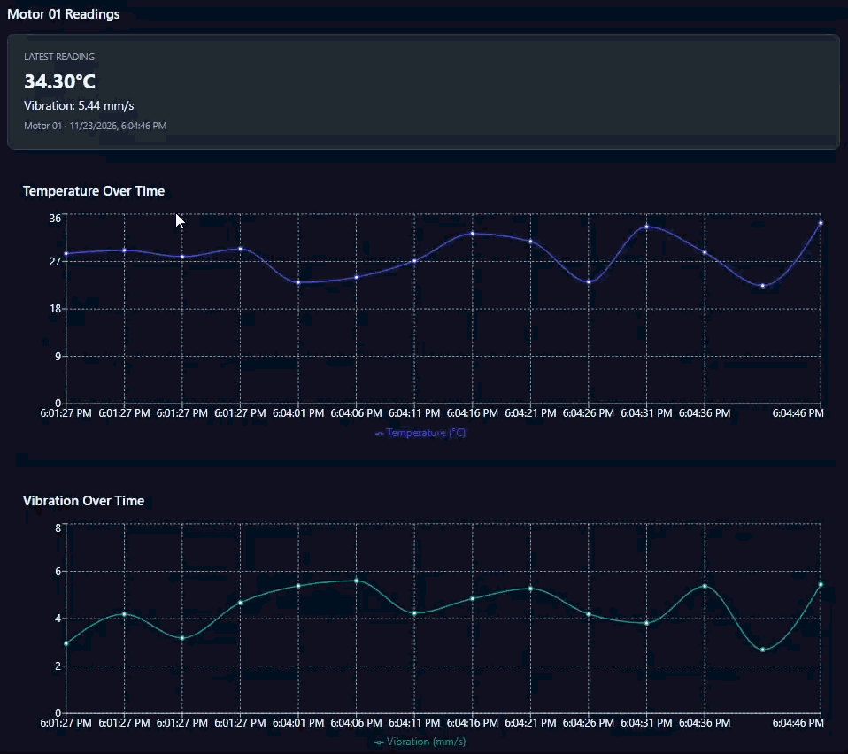
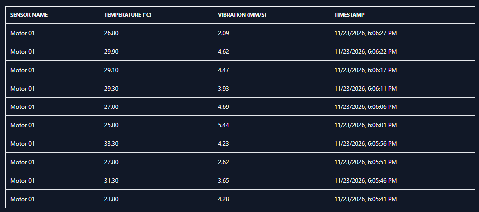
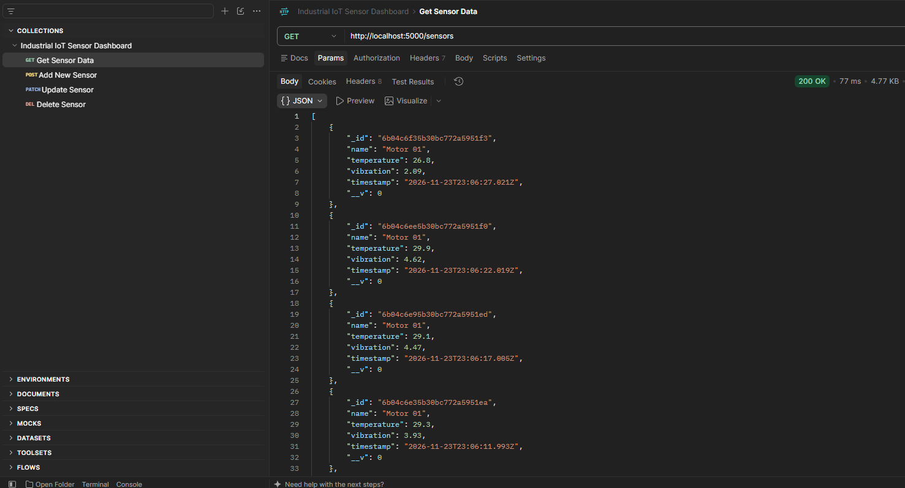

# Industrial IoT Sensor Dashboard (MERN Stack)

This is a full-stack IoT sensor dashboard that collects, stores, and displays temperature and vibration sensor data using the **MongoDB, Express, React, Node.js (MERN)** stack. The backend creates RESTful API endpoints to perform CRUD operations on the database, while the frontend displays real-time sensor data in charts and tables. This dashboard is designed to be a scalable to support a varierty of IoT applications that require sensor data monitoring and analytics.

To aid development and demonstration, the backend includes a script to populate MongoDB with sample data. Additionally, a sensor simulator script generates new data every 5 seconds. As new readings are created, the frontend dashboard automatically refreshes and displays the latest values. This simulates a real-world continuous monitoring environment typical of industrial IoT solutions.

## Key Features ##

- Backend built with Node.js and Express to structure API endpoints and database operations
- Sensor simulator script generates sample data to the API every 5 seconds
- MongoDB used to store the sensor data with timestamps
- Frontend is built with React, TypeScript, and TailwindCSS to create an interactive dashboard
- Dashboard automatically refreshes to reflect data polled every 5 seconds
- Postman collection for testing the API endpoints and CRUD operations

## How It Works

1. **Generate:** `sensorSimulator.js` creates a simulated temperature and vibration reading for Motor 01 every 5 seconds and sends it to the API with `POST /sensors`.
2. **Store:** The Express server validates the request and saves it to MongoDB through a Mongoose model. The new reading, including its `_id`, is returned in the response.
3. **Serve:** `GET /sensors` returns the most recent readings, newest first. It accepts optional `name` (exact motor name) and `limit` (1 to 500, default 50) query parameters.
4. **Display:** The React dashboard requests `GET /sensors?name=Motor 01&limit=50` when it loads and again every 5 seconds. It shows the latest reading, temperature and vibration charts, and a table of the 10 most recent readings.

The dashboard updates by polling the API. It does not use WebSockets or server push.

```
sensorSimulator.js --POST--> Express API <--> MongoDB
                                  ^
                                  | GET every 5 s
                           React dashboard
```

## Project Structure

| Path | Purpose |
| ---- | ------- |
| `backend/server.js` | Express app: connects to MongoDB and defines the `/sensors` routes (GET, POST, PATCH, DELETE) |
| `backend/models/sensor.js` | Mongoose schema: `name`, `temperature`, `vibration`, `timestamp` |
| `backend/seed.js` | Clears the collection and inserts sample Motor 01 readings |
| `backend/sensorSimulator.js` | Sends a simulated reading to the API every 5 seconds |
| `backend/.env.example` | Template for `PORT`, `MONGO_URI`, and `API_URL` |
| `frontend/src/main.tsx` | React entry point |
| `frontend/src/App.tsx` | Renders the dashboard for a chosen motor |
| `frontend/src/Dashboard.tsx` | Polls the API and renders the latest reading, charts, and table |
| `frontend/.env.example` | Template for `VITE_API_URL` |
| `postman/` | Postman collection for testing the CRUD endpoints |


## Screenshots ##

*Display of temperature and vibration data fetched from MongoDB while simulator is running.*



<br>
<br>


*Display of collected temperature and vibration data on the dashboard.*



<br>
<br>

*Sample GET request tested using Postman collection.*



<br>
<br>

# Installation Instructions

## 1. Clone the Repo ##

```Bash
git clone https://github.com/danreid44/iot-sensor-dashboard.git
cd iot-sensor-dashboard
```

## 2️. Set Up the Backend ##

```Bash
cd backend
npm install  # Install dependencies
cp .env.example .env  # Configure your MongoDB URI in .env
node seed.js  # Populate MongoDB with sample data
npm start  # Start backend server at http://localhost:5000/sensors
node sensorSimulator.js # Start simulator (generate data every 5 sec)
```

## 3. Set Up the Frontend ##

```Bash
cd frontend
npm install  # Install dependencies
cp .env.example .env  # Configure the API URL if needed
npm run dev # Run frontend server at http://localhost:5173
```

## API Endpoints ##

| Method | Route          | Description |
| ------ | -------------- | ----------- |
| GET    | `/sensors`     | Fetch sensor data, limit (default 50, max 500) and sensor name are optional query parameters |
| POST   | `/sensors`     | Add new sensor data and return created reading information |
| PATCH  | `/sensors/:id` | Update a sensor record of ID |
| DELETE | `/sensors/:id` | Delete a sensor record of ID |
